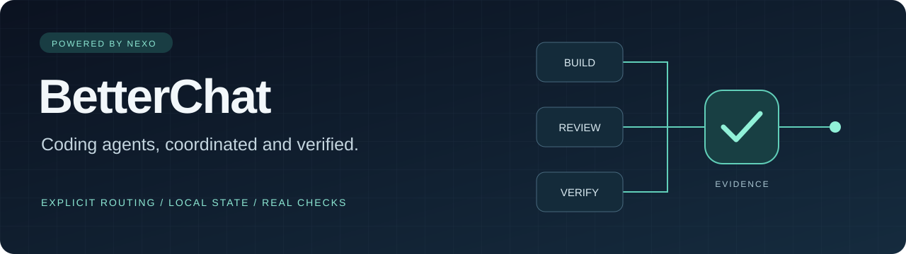
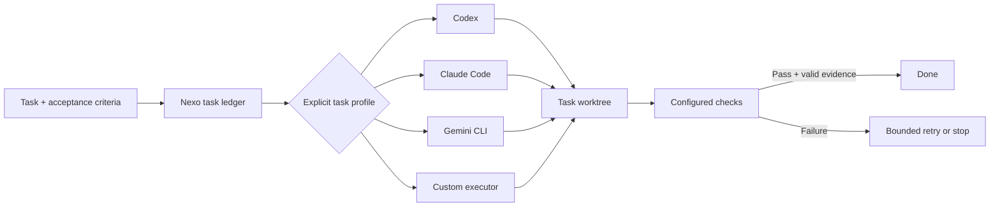

# BetterChat

**Your coding agents. One workflow.**

[](https://github.com/Israelcodigo/betterchat/actions/workflows/ci.yml)
[](pyproject.toml)
[](LICENSE)

[Español](README.es.md) · [Quick start](#quick-start) · [Development](docs/VERIFICATION.md) · [Contributing](CONTRIBUTING.md)

BetterChat is a local orchestration toolkit for **coding agents**, powered by
the **Nexo engine**. Assign tasks to Codex, Claude Code, Gemini CLI or a custom
executor; carry changes through Git worktrees; require checks before work is
marked done. It is a developer CLI and local dashboard, not a chat application.

> **1.3.0rc1 · Early release.** Python standard library at runtime. No API key is
> needed for the offline demo. Live runs use your installed clients and accounts.

## What it does

| Capability | What you get |
|---|---|
| Task-specific providers | Explicit provider/model profiles, with no silent fallback |
| Durable coordination | Task dependencies, leases, bounded retries and resumable local state |
| Isolated changes | One Git worktree per task, with explicit integration |
| Configurable checks | Project-defined commands before task completion |
| Context and memory | Searchable project records, checkpoints and reviewed learning candidates |
| Client integration | Nine skills, four base roles, MCP, hooks and a local dashboard |



## Quick start

Requires **Python 3.11+** and **Git**. On systems where Python is named `python3`,
use that command instead. Run from the repository root:

```shell
git clone https://github.com/Israelcodigo/betterchat.git
cd betterchat
python -B examples/demo.py
```

The demo creates its own temporary repository, runs three tasks, deliberately
fails and repairs one, verifies dependencies, and integrates the result. It prints
where the retained evidence lives. **Its workers are deterministic test programs;
no language model or credential is used.**

Run the development checks:

```shell
python -B -m unittest discover -s tests -v
python -B scripts/release_audit.py
```

## Use it in your project

Install from this checkout; the distribution and executable retain the Nexo name:

```shell
python -m pip install .
nexo --help
nexo init /path/to/your-project --state-only
```

`--state-only` initializes the local ledger. To install client skills, roles,
hooks or MCP, follow the [installation manual](docs/MANUAL.md) (Spanish).
Open the local dashboard from an initialized project with `nexo dashboard`.

Before running agents, create tasks with acceptance criteria, configure meaningful
checks, and commit the project's starting point. See [provider routing](docs/PROVIDERS.md)
for a complete configuration reference (Spanish).

### Choose a provider per task

For existing tasks with IDs `implement` and `review`, save `routes.json`:

```json
{
  "version": 1,
  "profiles": {
    "builder": {"backend": "codex"},
    "reviewer": {"backend": "claude"}
  },
  "tasks": {"implement": "builder", "review": "reviewer"}
}
```

```shell
nexo --project /path/to/your-project run --routing-file routes.json --workers 1 --cycles 1
```

Make `review` depend on `implement` to inherit its changes. The task contract,
not the profile name, defines the worker's role. Add `"model": "YOUR_MODEL_ID"`
to select a model explicitly; otherwise the client uses its own default.

### Try a real client

With a client installed and authenticated, explicitly opt in to a small repair:

```shell
python -B examples/provider_smoke.py --backend codex --run-model
```

Also accepts `claude`, `gemini` and `--model ID`. This consumes account usage.
Four acceptance cases run from the coordinator, outside the worker's worktree.
Missing clients and provider errors are reported as failures.

## Project guide

| Resource | Contents |
|---|---|
| [Spanish guide](README.es.md) | Overview and commands in Spanish |
| [Manual](docs/MANUAL.md) | Installation, checks, tasks and client integrations · ES |
| [Providers](docs/PROVIDERS.md) | Routing schema and native CLI contracts · ES |
| [Architecture](docs/DESIGN.md) | State, orchestration and design decisions · ES |
| [Changelog](CHANGELOG.md) | Changes in this release candidate |
| [Contributing](CONTRIBUTING.md) | Development checks and pull request guidance |
| [Security](SECURITY.md) | Execution boundaries and reporting |
| [Provenance](docs/PROVENANCE.md) | Design influences and attribution · ES |

## Contribute

Contributions are welcome: provider integrations, cross-platform improvements,
documentation, and reproducible bug reports. [Open an issue](https://github.com/Israelcodigo/betterchat/issues/new/choose)
with a reproducible case or send a focused pull request.

Project state and logs stay in `.nexo/`, excluded from Git. Worktrees isolate
changes, not operating-system permissions. Read [SECURITY.md](SECURITY.md) before
running untrusted projects.

Released under the [MIT license](LICENSE). Provider names belong to their
respective owners; this project is not affiliated with or endorsed by them.
